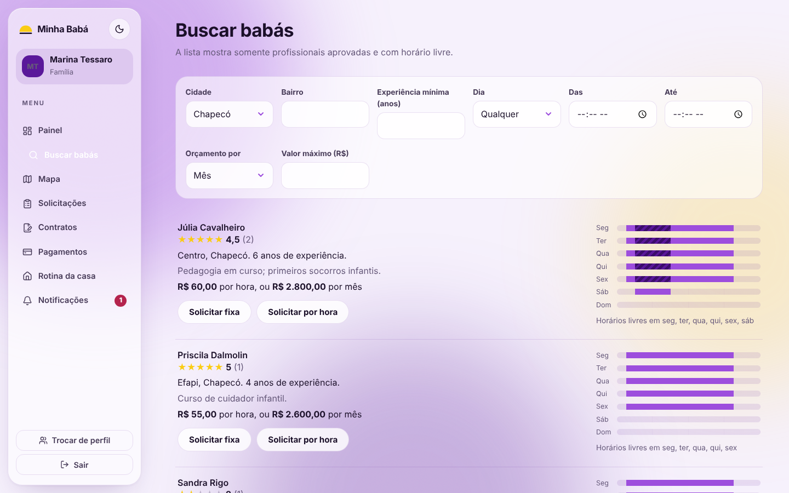
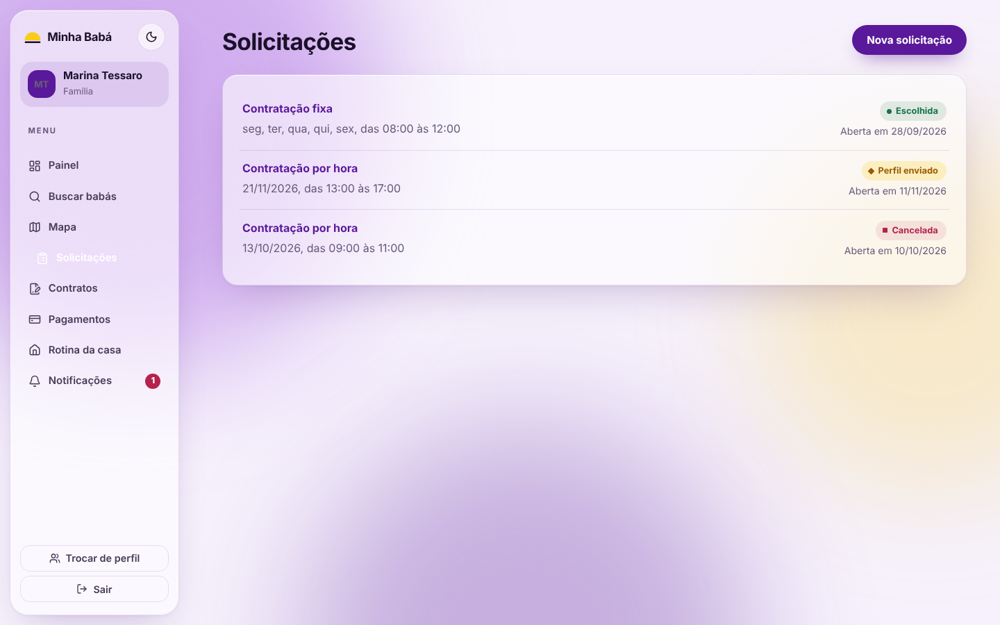
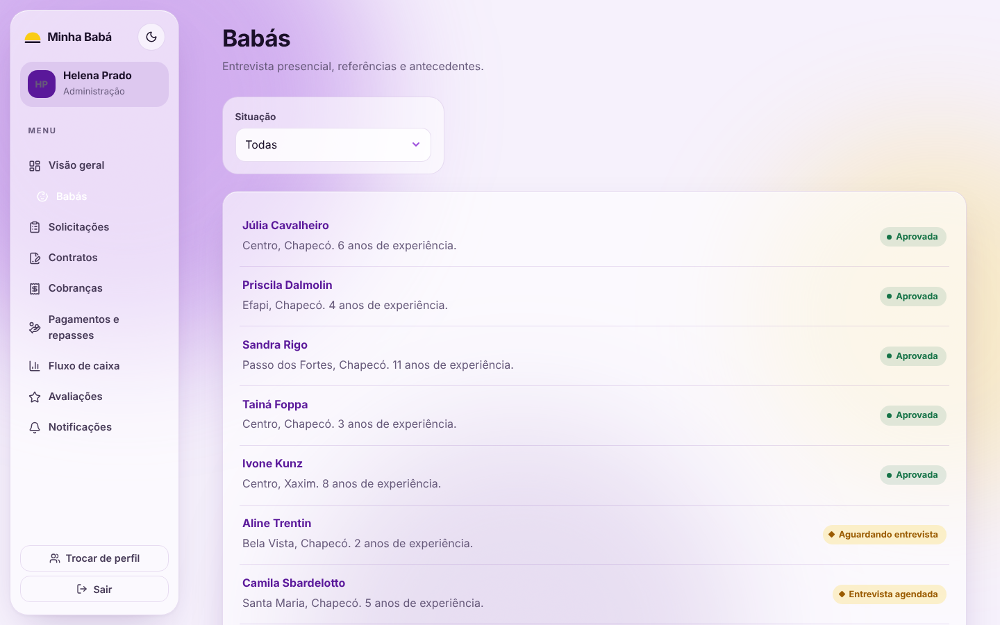

# Minha Babá

Plataforma que conecta famílias a babás aprovadas, com busca por mapa. Projeto final de Engenharia de Software (Ciência da Computação).

**Demo online:** https://minha-baba-beta.vercel.app · **Mapa:** https://minha-baba-beta.vercel.app/mapa

> Este repositório é a apresentação pública do projeto. O código-fonte fica em um repositório privado. Todos os dados da demo são fictícios.

## O que o projeto faz

- **Mapa de babás** (cidade de exemplo: Chapecó, SC): a família busca por raio, experiência, horários e orçamento.
- **Contas e solicitações**: famílias criam conta e enviam solicitações a partir do mapa.
- **Painel administrativo**: aprovação de babás após entrevista.
- **Página inicial** com design em vidro fosco e animações de rolagem.

## Telas

Capturas do protótipo com dados fictícios.

| | |
|---|---|
| **Escolha de perfil** (família, babá ou administração) | **Painel da família** |
|  |  |
| **Busca de babás** (só aprovadas e com horário livre) | **Solicitações** |
|  |  |
| **Painel da babá** | **Painel da administração** |
|  |  |

**Administração de babás**

## Privacidade por padrão

- A localização exibida no mapa é aproximada: sorteada entre 200 e 600 m do ponto real e fixa até o endereço mudar.
- Endereço, CPF, RG, telefone e e-mail nunca saem pela busca pública.
- Só babás aprovadas e com agenda livre aparecem no mapa.

## Tecnologias

React 19 · TypeScript · Vite · Leaflet · Supabase (Postgres, PostGIS, Auth, RLS) · Vercel · GSAP · Framer Motion · Vitest

## Arquitetura

| Camada | Função |
|---|---|
| Frontend (React + Vite) | Mapa, filtros, lista, contas e solicitações |
| Supabase | Dados, regras de acesso (RLS) e busca geográfica |
| Vercel | Hospedagem e função de geocodificação |
| OpenStreetMap / Nominatim | Mapa-base e conversão de CEP/bairro em coordenadas |

## Créditos

Mapa © colaboradores do OpenStreetMap (ODbL). Geocodificação via Nominatim, respeitando a política de uso.

## Autor

Perin ([@AwsGames-byte](https://github.com/AwsGames-byte))
